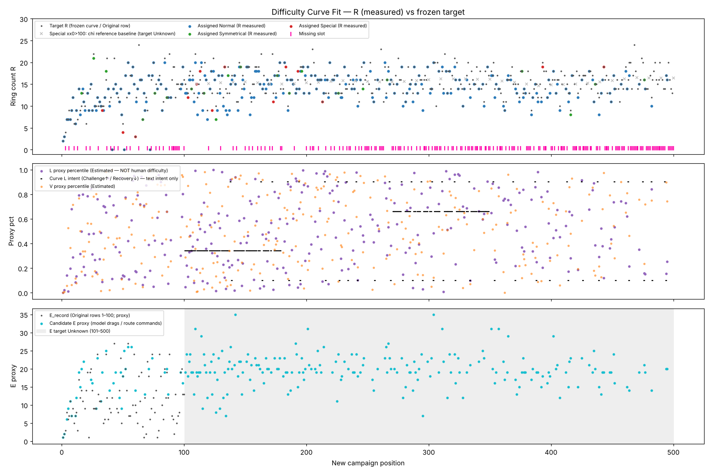

# DIFFICULTY CURVE FIT REPORT — New Campaign 500

Curve dùng: `TARGET_CURVE_500_FROZEN.json` (SHA256 `36c26eb4…3004c`, khớp hash đã đóng băng; không chỉnh sửa). Bản `..._WITH_CHAINS_PROPOSED` chỉ thêm overlay xích, R/V/L/E giống hệt.

## Nguồn target theo slot

- R_target số (frozen): 360 slot.
- 1–100: dùng dòng Original observation (frozen) — 100 slot.
- Special đuôi 0 sau 100: target R **Unknown**; chỉ dùng `R_reference_baseline` làm ngữ cảnh — 40 slot. Không coi là target chính thức.
- V_spatial, L_human_difficulty, E_human_effort: **Unknown** ở mọi slot. L chỉ có *intent* văn bản (Challenge/Recovery/…); E chỉ có E_record cho 1–100 (proxy).
- Không có đường "Human Difficulty measured" nào trong báo cáo này; mọi V/L/E của candidate là **Estimated / Proxy**.

## Mức bám R theo đoạn

| Đoạn | Đã xếp / slot | mean |dR| | tỉ lệ |dR|≤2 |
|---|---|---|---|
| 1–50 | 39/50 | 0.38 | 97% |
| 51–100 | 33/50 | 0.12 | 100% |
| 101–150 | 45/50 | 1.58 | 78% |
| 151–200 | 39/50 | 0.74 | 95% |
| 201–250 | 32/50 | 0.34 | 97% |
| 251–300 | 27/50 | 0.67 | 93% |
| 301–350 | 23/50 | 0.43 | 100% |
| 351–400 | 27/50 | 0.63 | 100% |
| 401–450 | 21/50 | 0.52 | 95% |
| 451–500 | 12/50 | 0.50 | 92% |

Toàn campaign: 298/500 slot có level; mean |dR| = 0.64; median 0; 94% trong ±2 ring; max 5.

## Nhịp Challenge / Recovery (L proxy)

- Slot intent Challenge: 17 level, L proxy trung bình 0.80.
- Slot intent Recovery: 24 level, L proxy trung bình 0.19.
- Slot khác: 168 level, L proxy trung bình 0.52.
- L proxy = độ sâu chuỗi link + số lần quay lại object trong route model + tỉ lệ gốc + số cơ chế. Không phải đo người chơi.

## Scoring & trọng số (đề xuất, chưa được GD phê duyệt)

`fit = wR·min(6,|R−R_t|/tol)^1.5 + wE·|E−E_t|/… (chỉ 1–100) + wL·intent·(0.5−Lpct)·2 + wV·max(0,Vpct−0.85)·6 (sau 100) + wQ·(1−scene) + wProof·[unverified]`

- tol = max(1.5, 12%·R_t) Normal; max(2, 15%) Symmetrical; max(3, 22%) Special (×0.6 trọng số vì target Special phần lớn Unknown).
- Level dễ hơn đích được giảm phạt ở slot intent Recovery (×0.6) và sau đoạn gốc (×0.85) — để có level thở, không ép đường cong phẳng.
- Thưởng lấp slot = miss + early·(1−pos/500)² ; slot không có candidate đủ gần → để Missing (không ép).
- Adjacency: phạt cặp liền kề quá giống, chuỗi cùng family >3, chuỗi ring-only >3, cửa sổ 10 có >6 cùng macro-family, nhóm "bố cục tương đương" của GD gần nhau <12, biến thể cùng source gần nhau <15, bước nhảy R lớn hơn curve >6.

| Trọng số | Giá trị |
|---|---|
| R | 1.0 |
| E | 0.6 |
| L | 0.5 |
| V | 0.4 |
| Q | 0.8 |
| proof | 0.3 |
| miss | 3.2 |
| early | 1.0 |
| nb | 1.0 |
| jump | 0.3 |
| streak | 0.25 |
| simset | 0.9 |
| window | 0.15 |
| macro | 0.45 |

## Sensitivity check

Mỗi phương án: Hungarian + annealing 25k bước với trọng số thay đổi. "same_position" = số level giữ đúng vị trí so với bản chính.

| Phương án | assigned | same position | thay đổi tập chọn | mean |dR| | median shift | p90 shift |
|---|---|---|---|---|---|---|
| R x1.5 | 294 | 25 | 4 | 0.68 | 112.5 | 306.4 |
| R x0.5 | 302 | 18 | 4 | 1.35 | 104.0 | 276.20000000000005 |
| L x2 | 298 | 26 | 0 | 0.87 | 105.5 | 291.90000000000003 |
| L x0 | 298 | 22 | 0 | 0.84 | 100.0 | 290.90000000000003 |
| Q x2 | 298 | 33 | 0 | 0.78 | 94.0 | 309.3 |
| adjacency x2 | 298 | 29 | 0 | 0.73 | 106.0 | 296.0 |
| adjacency x0.5 | 298 | 33 | 0 | 0.8 | 89.5 | 303.3 |
| early fill 0 | 298 | 28 | 0 | 0.86 | 110.0 | 306.3 |
| early fill x2 | 299 | 29 | 1 | 1.0 | 92.5 | 274.90000000000003 |

**Kết luận sensitivity:** tập level được chọn rất ổn định (0–4 thay đổi), mức bám R ổn định (mean |dR| 0.7–1.4). Nhưng vị trí *chính xác* của các level R 13–17 trong đoạn 101–500 thay đổi nhiều giữa các phương án (median dịch ~100) vì curve gần như phẳng (R_target 13–17 lặp lại suốt 400 slot) và Human L/E Unknown — nhiều thứ tự tương đương về điểm. Thứ tự cụ thể trong đoạn này cần playtest/GD quyết; mapping hiện tại là một nghiệm tốt, không phải nghiệm duy nhất.

## Giới hạn

- Không có replay mới cho việc đổi vị trí (gameplay payload không đổi; proof tái sử dụng theo hash).
- Không có đo Human Difficulty; Native Unity/device: Unknown.
- 202 slot Missing — đường cong ở các đoạn đó chưa được thực hiện.